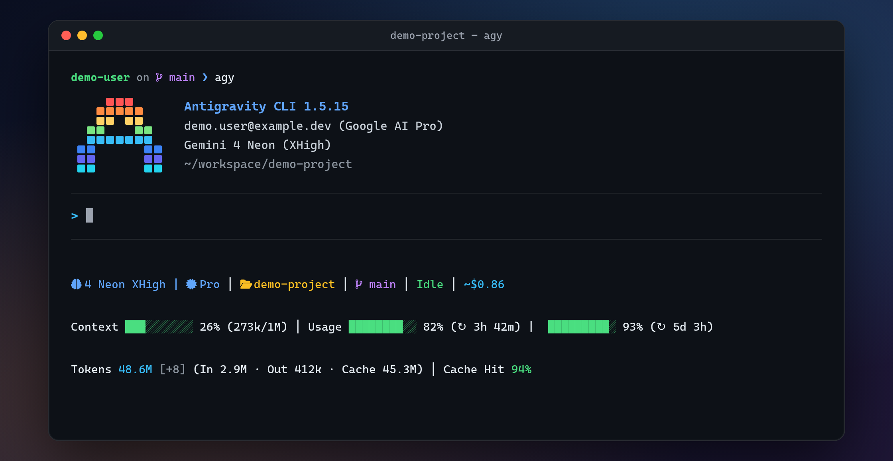

# agy-cli-statusline

[简体中文](README.md) | **English**

An enhanced **Antigravity CLI (`agy`) status-line HUD plugin** adding **cumulative session token breakdown (with recursive `/swarm` & subagent aggregation)**, **prompt cache hit rate**, and **low-latency adaptive quota refresh** on top of a compact, zero-dependency terminal HUD.

> **Upstream Attribution**: Derived from [`franksde/agy-hud`](https://github.com/franksde/agy-hud) (`v0.1.12`, MIT License). Original copyright notices and bundled third-party licenses are preserved in [LICENSE](LICENSE) and [THIRD_PARTY_NOTICES.md](THIRD_PARTY_NOTICES.md).



---

## What's Added Over Upstream `franksde/agy-hud`

- **Cumulative Session Token Breakdown (`show_session_tokens`)**: Adds a clean 3rd HUD line displaying cumulative session **Total**, uncached **In**, **Out** (including thinking tokens), and **Cache** read tokens (matching `ccusage antigravity` totals exactly).
- **Prompt Cache Hit Rate (`show_cache_hit_rate`, `cache_hit_rate_mode`)**: Displays `Cache / (In + Cache)` colored by hit efficiency (`>=70%` green, `>=40%` yellow, `<40%` orange), configurable across `"session"`, `"last"`, or `"both"`.
- **Recursive `/swarm` & Subagent Aggregation (`include_subagent_tokens`)**: Automatically discovers and aggregates all spawned `/swarm` workers, nested worker helpers, `invoke_subagent`, and `run_workflow` transcripts with a `[+N]` badge, while strictly ignoring UUIDs appearing inside `read_file`, `run_command`, or `read_board` outputs.
- **Sub-Millisecond Incremental Transcript Cache**: Tracks `inode + mtime + byte offset` per transcript in `session_tokens_cache.json` (128-entry LRU, `0600` permissions) with native `Buffer.includes` pre-filtering — `<1ms` warm redraws with zero disk writes while idle.
- **Adaptive Low-Latency Quota Refresh**:
  - Three-tier schedule (`quota_active_interval_sec=20`, `quota_settled_cooldown_sec=10`, `quota_idle_interval_sec=120`) replacing the original 60s/5min lockouts, with turn-advance `dirty` tracking and immediate expired-window refresh.
  - Bounded in-flight wait (`quota_inflight_wait_ms=1200`) exclusively on `active -> idle` transitions when a background `/usage` refresh is already running, capturing fresh quota in the same frame without blocking typing or streaming.
  - Atomic temp-file + `rename` writes and clean window-rollover merging in `mergeQuotaBuckets`.

---

## Requirements

- **Antigravity CLI (`agy`)** `1.1.0+` (verified on `1.5.15`)
- **Node.js 18+** (zero runtime npm dependencies; `hooks/status-line.sh` automatically discovers Node across `PATH`, nvm, fnm, Volta, mise, asdf, nodenv, n, and Homebrew)
- **macOS / Linux**
- Optional Nerd Font for icons (set `"show_icons": false` for plain text)

---

## Installation

### Install as an Antigravity CLI Plugin (Recommended)

```bash
git clone https://github.com/mawwalker/agy-cli-statusline.git
cd agy-cli-statusline
./scripts/install-local.sh
```

Then activate it inside `agy`:

```text
/statusline ~/.gemini/config/plugins/agy-cli-statusline/hooks/status-line.sh
```

### Or Drop-In Replace an Existing `agy-hud` Bundle

```bash
cp dist/agy-hud.js ~/.gemini/config/plugins/agy-hud/dist/agy-hud.js
node ~/.gemini/config/plugins/agy-hud/dist/agy-hud.js version
```

---

## Configuration

Config lookup priority:

1. `AGY_HUD_CONFIG` environment variable
2. `config.json` inside the plugin directory
3. `$XDG_CONFIG_HOME/agy-cli-statusline/config.json` or `~/.config/agy-cli-statusline/config.json`
4. Backward-compatible fallback: `$XDG_CONFIG_HOME/agy-hud/config.json` or `~/.config/agy-hud/config.json`

Copy [config.example.json](config.example.json) to `~/.config/agy-cli-statusline/config.json` to customize:

| Key | Values | Default | Description |
| --- | --- | --- | --- |
| `show_session_tokens` | `boolean` | `true` | Show cumulative session `Tokens (In · Out · Cache)` |
| `show_cache_hit_rate` | `boolean` | `true` | Show prompt `Cache Hit` percentage |
| `include_subagent_tokens` | `boolean` | `true` | Recursively include `/swarm` workers & subagents (`[+N]` badge) |
| `cache_hit_rate_mode` | `"session"` \| `"last"` \| `"both"` | `"session"` | Hit-rate scope: cumulative session, latest turn, or both |
| `session_tokens_layout` | `"line"` \| `"inline"` | `"line"` | Dedicated 3rd line, or attempt inline on Line 2 on wide terminals |
| `quota_active_interval_sec` | `10`–`600` | `20` | Background `/usage` refresh interval while active (seconds) |
| `quota_settled_cooldown_sec` | `5`–`600` | `10` | Minimum cooldown after a turn settles or new turns occur (seconds) |
| `quota_idle_interval_sec` | `15`–`3600` | `120` | Refresh interval when truly idle with no new turns (seconds) |
| `quota_inflight_wait_ms` | `0`–`3000` | `1200` | Max wait on `active -> idle` if a refresh is already running (`0` disables) |
| `context_value` | `"percent"` \| `"tokens"` \| `"both"` | `"percent"` | Context window display format |
| `usage_value` | `"remaining"` \| `"percent"` | `"remaining"` | Quota display as remaining or used percentage |
| `multiline` | `boolean` | `true` | Multi-line HUD (`false` for compact single line) |
| `show_progress_bar` | `boolean` | `true` | Render context & quota progress bars |
| `show_icons` | `boolean` | `true` | Render Nerd Font icons (`false` for plain text) |
| `show_model`, `show_cwd`, `show_git_branch`, `show_agent_state`, `show_cost`, `show_title`, `color` | `boolean` | see [config.example.json](config.example.json) | Standard HUD toggles |

---

## Testing & Diagnostics

```bash
node --test test/hud.test.js
node dist/agy-hud.js version
node dist/agy-hud.js doctor
```

## Privacy & License

Local-only rendering with zero external network calls; see [SECURITY.md](SECURITY.md). Licensed under the **MIT License** — see [LICENSE](LICENSE) and [THIRD_PARTY_NOTICES.md](THIRD_PARTY_NOTICES.md).
