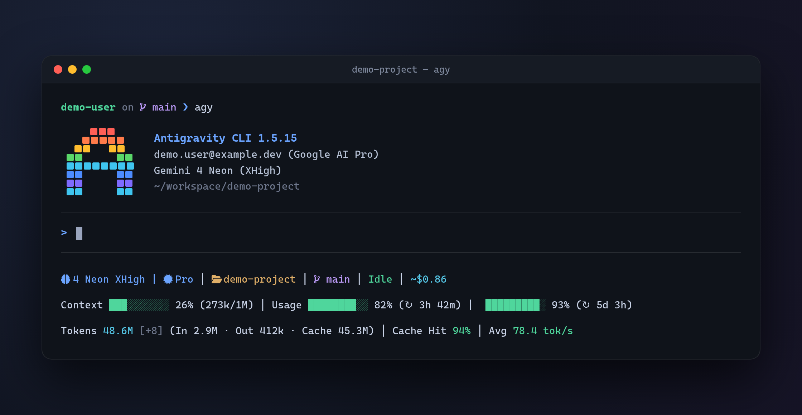

# agy-cli-statusline

**简体中文** | [English](README.en.md)

一个增强版 **Antigravity CLI (`agy`) 状态栏 HUD 插件**，在保留紧凑清晰终端排版的基准上，新增 **会话累计 Token 统计（含 `/swarm` 与 Subagent 递归汇总）**、**Prompt 缓存命中率**、**会话输出均速 (`tok/s`)** 以及 **低延迟自适应配额刷新**。

> **上游致谢**：本项目基于优秀的开源项目 [`franksde/agy-hud`](https://github.com/franksde/agy-hud)（`v0.1.12`，MIT License）二次开发和维护。保留其完整的 MIT 许可与第三方声明（见 [LICENSE](LICENSE) 与 [THIRD_PARTY_NOTICES.md](THIRD_PARTY_NOTICES.md)）。



---

## 相比上游 `franksde/agy-hud` 新增与增强的功能

| 维度 | 上游 `agy-hud v0.1.12` | 本仓库 `agy-cli-statusline v0.3.0` |
| --- | --- | --- |
| **会话累计 Token 明细** | 仅显示当前上下文窗口占比 (`Context`) | **新增第 3 行**，实时汇总当前会话累计消耗：**总量、新输入 (`In`)、输出含思考 (`Out`)、缓存读取 (`Cache`)**（以及可选 `CWrite`），口径与 `ccusage antigravity` 精确对齐 |
| **Prompt 缓存命中率** | 不支持 | **新增 `Cache Hit` 命中率** `Cache / (In + Cache)`，按命中质量自动着色（`≥70%` 绿、`≥40%` 黄、`<40%` 橙），支持 **会话累计 (`session`) / 最近一轮 (`last`) / 双显示 (`both`)** |
| **会话平均输出速度 (`tok/s`)** | 不支持 | **新增 `Avg XX tok/s` 加权输出均速**（`Σoutput_tokens / Σ推理耗时`）：并行工具调用精准对齐至最后一个工具派发时间、纯文本终答取落盘 `mtimeMs`，自动剔除工具执行/人工审批/用户停顿时间；按速率着色（`≥60` 绿、`≥30` 黄、`<30` 橙） |
| **`/swarm` & Subagent 递归汇总** | 不支持 | **自动递归发现并累加所有 `/swarm` Worker、嵌套 Helper、Subagent 与 Workflow 子会话**的 Token 与缓存命中率，并以 `[+N]` 徽标直观提示子 Agent 数量；同时严格过滤 `read_file` / `run_command` / `read_board` 输出防止误统计 |
| **增量字节偏移缓存** | 无 | 按 `inode + mtime + offset` 增量扫描 `transcript.jsonl`，并用原生 `Buffer.includes` 跳过非 Token 行；128 条会话 LRU 缓存，空闲重绘 **< 1ms 且零磁盘写入** |
| **配额刷新实时性** | 活跃 `60s` / 空闲 `5min`，且结束后易被 60s 冷却锁死、后台完成后不接力 | **三级自适应节奏**：活跃期 `20s` 预刷、回合结束 / 轮次递增产生 `dirty` 标记时冷却仅 `10s`、真正空闲回落 `120s`；回合结束（`active -> idle`）若已有刷新在途，异步短等最多 `1200ms` 争取**当帧直接呈现新额度**（打字/流式输出 `0ms` 不阻塞） |
| **可靠性与边界修复** | 直接覆写缓存 | 缓存与状态文件全部改为 **临时文件 + `rename` 原子写入**；修复配额周期刚重置时旧窗口缓存压住新窗口 `100%` 的时钟偏移问题；后台刷新支持 `--min-age` 透传 |

---

## 运行要求

- **Antigravity CLI (`agy`)** `1.1.0` 或更高版本（已在 `1.5.15` 实测验证）
- **Node.js 18+**（零运行时依赖，无需 `npm install`；`hooks/status-line.sh` 会自动在 `PATH` 及 nvm / fnm / Volta / mise / asdf / nodenv / n / Homebrew 路径下定位 Node）
- **macOS / Linux**
- 如需显示图标，终端字体需包含 Nerd Font 字形；若未安装 Nerd Font，将配置中的 `"show_icons"` 设为 `false` 即可切换为纯文本模式

---

## 安装与启用

### 方式一：使用仓库自带脚本一键安装（推荐）

> 不要把 git 仓库根目录直接传给 `agy plugin install`，否则 `.git/`、`test/` 等目录会被一并拷贝进插件目录。仓库提供了干净的打包安装脚本：

```bash
git clone https://github.com/mawwalker/agy-cli-statusline.git
cd agy-cli-statusline
./scripts/install-local.sh
```

然后在 Antigravity CLI 交互界面中执行一次接线命令：

```text
/statusline ~/.gemini/config/plugins/agy-cli-statusline/hooks/status-line.sh
```

### 方式二：原地覆盖已有 `agy-hud` 插件

如果你之前已经安装并挂载了 `agy-hud`，也可以直接覆盖其运行脚本（接线配置无需修改）：

```bash
cp dist/agy-hud.js ~/.gemini/config/plugins/agy-hud/dist/agy-hud.js
node ~/.gemini/config/plugins/agy-hud/dist/agy-hud.js version
```

---

## 配置说明

插件按以下优先级读取配置（推荐放在用户配置目录，避免重装插件时被覆盖）：

1. 环境变量 `AGY_HUD_CONFIG`
2. 插件目录下的 `config.json`
3. `$XDG_CONFIG_HOME/agy-cli-statusline/config.json` 或 `~/.config/agy-cli-statusline/config.json`
4. 向后兼容回退：`$XDG_CONFIG_HOME/agy-hud/config.json` 或 `~/.config/agy-hud/config.json`

复制示例配置即可自定义：

```bash
mkdir -p ~/.config/agy-cli-statusline
cp config.example.json ~/.config/agy-cli-statusline/config.json
```

### 完整配置项

| 配置项 | 类型 / 可选值 | 默认值 | 说明 |
| --- | --- | --- | --- |
| `show_session_tokens` | `boolean` | `true` | 显示当前会话累计 `Tokens (In · Out · Cache)` |
| `show_cache_hit_rate` | `boolean` | `true` | 显示 Prompt 缓存命中率 `Cache Hit` |
| `show_token_speed` | `boolean` | `true` | 显示会话加权平均输出速度 `Avg XX tok/s`（剔除工具耗时与人工等待） |
| `include_subagent_tokens` | `boolean` | `true` | 递归汇总当前会话派生的 `/swarm` Worker 与 Subagent Token（带 `[+N]` 标记） |
| `cache_hit_rate_mode` | `"session"` \| `"last"` \| `"both"` | `"session"` | 命中率口径：会话累计、最近一轮、或两者同时显示 |
| `session_tokens_layout` | `"line"` \| `"inline"` | `"line"` | 多行模式下独立第 3 行显示，或宽终端下尝试拼在第 2 行末尾 |
| `quota_active_interval_sec` | `number` (`10`–`600`) | `20` | 对话活跃期的后台配额刷新间隔（秒） |
| `quota_settled_cooldown_sec` | `number` (`5`–`600`) | `10` | 回合结束或检测到新消耗（`dirty`）后的配额刷新最小冷却（秒） |
| `quota_idle_interval_sec` | `number` (`15`–`3600`) | `120` | 完全空闲且无新消耗时的配额刷新间隔（秒） |
| `quota_inflight_wait_ms` | `number` (`0`–`3000`) | `1200` | `active -> idle` 时若已有后台刷新在途，最多等待的毫秒数（`0` 关闭） |
| `context_value` | `"percent"` \| `"tokens"` \| `"both"` | `"percent"` | 上下文窗口显示格式（如 `26%`、`272k/1M` 或 `26% (272k/1M)`） |
| `usage_value` | `"remaining"` \| `"percent"` | `"remaining"` | 配额显示剩余百分比或已用百分比 |
| `multiline` | `boolean` | `true` | 多行 HUD 模式；设为 `false` 切换为紧凑单行模式 |
| `show_progress_bar` | `boolean` | `true` | 显示上下文与配额进度条 |
| `show_icons` | `boolean` | `true` | 显示 Nerd Font 图标（无 Nerd Font 时设为 `false`） |
| `show_model` | `boolean` | `true` | 显示当前模型与套餐徽标 |
| `show_cwd` | `boolean` | `true` | 显示当前工作目录名 |
| `show_git_branch` | `boolean` | `true` | 显示当前 Git 分支（直接读取 `.git/HEAD`，不启动 `git` 进程） |
| `show_agent_state` | `boolean` | `true` | 显示 Agent 状态（`Idle` / `Thinking` / `Auth`） |
| `show_cost` | `boolean` | `true` | 显示 CLI 提供的会话估算费用 |
| `show_title` | `boolean` | `false` | 显示会话标题（最多 24 列，窄终端优先隐藏） |
| `color` | `boolean` | `true` | 启用 ANSI 终端配色 |

---

## 常用维护与测试命令

```bash
# 运行完整单元测试（零依赖，使用 Node 内置 test runner）
node --test test/hud.test.js

# 检查版本与环境自检（含 Nerd Font 图标探针）
node dist/agy-hud.js version
node dist/agy-hud.js doctor

# 手动触发一次配额刷新
node dist/agy-hud.js quota refresh
```

## 隐私与安全

- 所有统计均在本地完成，仅读取 `stdin` 状态栏 JSON、本地配置/缓存与本地只读 `transcript.jsonl`，不向任何外部服务发送数据。
- 本地缓存目录权限 `0700`、缓存文件权限 `0600`，且不保存原文对话内容或任何凭证。详见 [SECURITY.md](SECURITY.md)。

## 开源协议

本项目采用 **MIT License**，详见 [LICENSE](LICENSE) 与 [THIRD_PARTY_NOTICES.md](THIRD_PARTY_NOTICES.md)。上游项目：[`franksde/agy-hud`](https://github.com/franksde/agy-hud)。
